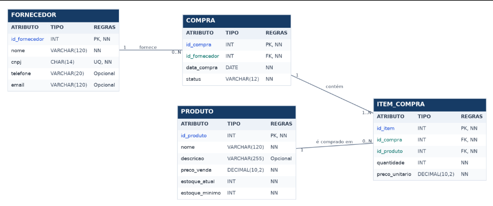

# Sistema de Gerenciamento de Estoque

Trabalho desenvolvido para a disciplina de **Banco de Dados (2026/2)** do professor **Howard Roatti**.

O projeto consiste em um sistema em terminal feito em **Python** integrado ao banco **Oracle**, gerenciando as tabelas `FORNECEDOR`, `PRODUTO`, `COMPRA` e `ITEM_COMPRA`.

## Integrantes

- Arthur Gava Calil
- André Luiz Alves Bofonha
- Miguel Gomes
- Kawan Wendler Goldner
- João Vitor Gnocchi da Cunha
- João Vitor Gera Bof

## Vídeo de Demonstração

Link do YouTube: [inserir link do vídeo aqui]

## Diagrama Relacional



## Passo a Passo para Rodar no Linux (VM da Disciplina)

### 1. Iniciar o banco Oracle
Abra o terminal na VM e suba o container do Oracle (caso ainda não esteja rodando):

```bash
docker start $(docker ps -aq)
```
*(Espere alguns segundos para o banco iniciar completamente).*

### 2. Clonar o repositório e instalar as dependências
No terminal, baixe o projeto, ative o ambiente virtual e instale os pacotes necessários:

```bash
git clone https://github.com/joaovitor0101/SistemaDeGerenciamentoDeEstoque.git
cd SistemaDeGerenciamentoDeEstoque

python3 -m venv .venv
source .venv/bin/activate
pip install -r requirements.txt
```

### 3. Criar as tabelas e inserir os dados iniciais
Entre na pasta `src` e rode o script que cria as tabelas e insere os registros de teste no banco (a conexão já está configurada para o usuário `labdatabase` padrão da VM):

```bash
cd src
python3 create_tables_and_records.py
```

### 4. Iniciar o programa
Ainda na pasta `src`, execute o arquivo principal:

```bash
python3 principal.py
```

## Funcionamento do Sistema

Ao iniciar, o programa mostra na tela os nomes do grupo e a contagem atual de registros em cada tabela, junto com as opções do menu:

- **1 - Relatórios:** exibe os relatórios do sistema (compras por fornecedor, itens de compra, produtos com estoque baixo e listagens individuais de fornecedores, produtos e compras).
- **2 - Inserir Registros:** cadastra novos registros nas tabelas.
- **3 - Remover Registros:** apaga um registro pelo ID após confirmação (tratando os vínculos com outras tabelas).
- **4 - Atualizar Registros:** altera os dados de um registro existente e mostra na tela o resultado atualizado.
- **5 - Sair:** fecha o sistema.
